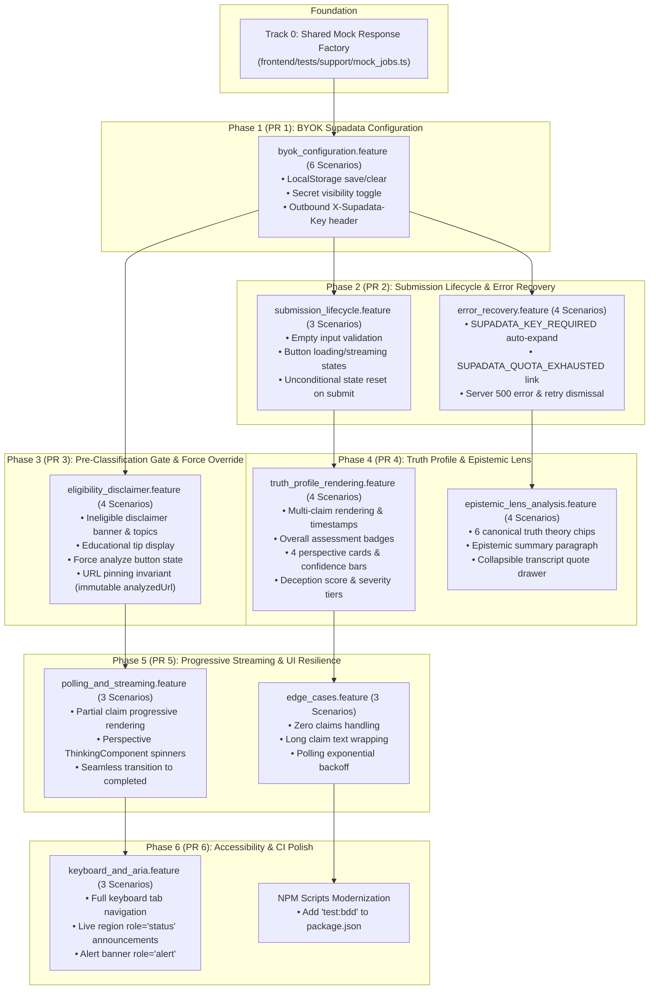

# Frontend Behavior-Driven Development (BDD) Test Implementation Plan

> **Author**: Antigravity SE Agent  
> **Status**: Approved Implementation Plan  
> **Baseline**: PR [#114](https://github.com/JAaron93/PerspectivePrism/pull/114) (`playwright-bdd` 9.2.1 + `@playwright/test` 1.64.1)  
> **Formal Specifications**:
> - [Architecture & Design Spec](docs/specs/frontend-bdd-testing/design.md)
> - [Requirements & Gherkin Scenarios](docs/specs/frontend-bdd-testing/requirements.md)
> - [Traceable Task Breakdown](docs/specs/frontend-bdd-testing/tasks.md)
> - [Frontend Invariants Rulebook](.agents/rules/frontend_invariants.md) §6

---

## Executive Summary

PR [#114](https://github.com/JAaron93/PerspectivePrism/pull/114) successfully laid the foundational harness for Gherkin acceptance testing in the React 19 SPA (`frontend/`):
- Installed `playwright-bdd` and `@playwright/test`
- Configured `playwright.config.ts` with `defineBddConfig` and Playwright's `webServer` auto-booting the Vite dev server (`npm run dev -- --strictPort`)
- Verified Chromium end-to-end execution with a single smoke scenario (`submit_analysis.feature`)

However, the React SPA orchestrates a wide range of user-facing workflows, reactive state machines, and resilience patterns that currently lack acceptance tests. Attempting to implement the entire acceptance suite in a single PR would result in over 2,000 lines of test code across 37 scenarios, overwhelming PR review bots (Greptile/CodeRabbit) and complicating defect isolation.

This plan details an **incremental, 6-phase rollout strategy** that distributes the implementation across dedicated, single-responsibility Pull Requests.

---

## Core Testing Architecture & Invariants

All BDD tests must adhere strictly to the invariants codified in [`.agents/rules/frontend_invariants.md`](.agents/rules/frontend_invariants.md) §6:

1. **Two-Phase Invocation**:
   ```bash
   cd frontend
   npx bddgen              # 1. Compile .feature files into .features-gen/ specs (MANDATORY)
   npx playwright test     # 2. Run compiled specs in Chromium against webServer
   ```
   > [!IMPORTANT]
   > `npx bddgen` must be executed before every test run and after any `.feature` file modification. `playwright test` does not automatically generate specs on its own.

2. **100% Offline Route Interception**:
   - Zero network requests to live backend, GCP Vertex AI, or Supadata APIs.
   - All tests use Playwright's `page.route('**/analyze/jobs*')` to fulfill deterministic `JobResponse` and `JobStatusResponse` mock payloads.

3. **Real DOM Interactions (No Synthetic Bypasses)**:
   - Tests must type into `#youtube-url`, click `.analyze-button`, toggle `#byok-toggle-btn`, and click `#pp-force-analyze-btn`.
   - Never dispatch synthetic `fetch` calls from the test script that bypass the component's internal action handlers.

4. **Domain-Relevant Fixture Discipline**:
   - Only use realistic journalism/news URLs (e.g. `https://www.youtube.com/watch?v=PBSNewsHour_BudgetBriefing`).
   - Never use Rick Astley or `dQw4w9WgXcQ` fixtures.

5. **Shared Mock Factory**:
   - A centralized, strongly-typed builder module (`frontend/tests/support/mock_jobs.ts`) synthesizes all mock responses conforming to `frontend/src/types/index.ts`.

---

## Phased Implementation Roadmap



---

## Detailed Phase Breakdown

### Foundation (Track 0): Shared Mock Response Factory
* **Target File**: `frontend/tests/support/mock_jobs.ts`
* **Purpose**: Centralizes typed factory functions to prevent boilerplate duplication across step definitions:
  - `createMockJob(jobId?: string): JobResponse`
  - `createMockCompletedStatus(jobId: string, options?: { claims?: ClientClaimAnalysis[], eligibility?: ContentEligibilityResult | null }): JobStatusResponse`
  - `createMockStreamingStatus(jobId: string, partialClaims: ClientClaimAnalysis[]): JobStatusResponse`
  - `createMockIneligibleStatus(jobId: string, details: { category: string, title: string, message: string, topics?: string[] }): JobStatusResponse`
  - `createMockFailedStatus(jobId: string, errorCode: string | null, errorMessage: string): JobStatusResponse`

---

### Phase 1 (PR 1): BYOK Supadata Configuration
* **Files**:
  - `frontend/tests/features/byok_supadata/byok_configuration.feature`
  - `frontend/tests/steps/byok_supadata.ts`
  - `frontend/tests/support/mock_jobs.ts`
* **Scenarios (6)**:
  1. Toggling the BYOK accordion expands/collapses `#byok-config-panel` and updates `aria-expanded`.
  2. Saving a key persists it to `localStorage` and updates the toggle button to `"Supadata API Key (Configured)"`.
  3. Clicking "Show"/"Hide" toggles input type between `password` and `text` with accessible `aria-label`.
  4. Clicking "Clear" removes the key from `localStorage` and resets the toggle button text.
  5. When a key is configured, outbound `POST /analyze/jobs` carries `X-Supadata-Key: <key>`.
  6. When no key is configured, outbound `POST /analyze/jobs` omits `X-Supadata-Key`.
* **PR Scope**: ~250 lines diff. Zero app code changes.

---

### Phase 2 (PR 2): Submission Lifecycle & Error Recovery
* **Files**:
  - `frontend/tests/features/analysis_submission/submission_lifecycle.feature`
  - `frontend/tests/features/error_handling/error_recovery.feature`
  - `frontend/tests/steps/analysis_submission.ts` (extend existing)
  - `frontend/tests/steps/error_handling.ts`
* **Scenarios (7)**:
  1. Empty input prevents submission via native HTML5 form validation.
  2. Submit button updates to `"Analyzing..."` (disabled) and transitions to `"Streaming..."`.
  3. **Unconditional State Reset (`frontend_invariants.md` §4)**: Submitting a new URL immediately clears previous analysis results and prior error banners from the DOM.
  4. `SUPADATA_KEY_REQUIRED` error auto-expands the BYOK panel and renders action links to supadata.ai.
  5. `SUPADATA_QUOTA_EXHAUSTED` error renders an action link to `https://supadata.ai/pricing`.
  6. Server 500 failure renders a clear error alert banner (`role="alert"`).
  7. Re-submitting a new video dismisses active error banners.
* **PR Scope**: ~350 lines diff.

---

### Phase 3 (PR 3): Pre-Classification Gate & Force Override Pinning
* **Files**:
  - `frontend/tests/features/pre_classification_gate/eligibility_disclaimer.feature`
  - `frontend/tests/steps/pre_classification_gate.ts`
* **Scenarios (4)**:
  1. Ineligible video displays `<EligibilityDisclaimer>` banner with ⚠️ icon, title `"Analysis Skipped"`, category badge (`Entertainment • 95% Match`), and topic chips.
  2. Educational tip displays advice to navigate to news or documentary videos.
  3. Clicking `"⚡ Analyze Anyway"` triggers job submission with `force_override: true` and shows loading spinner.
  4. **Force-Override Target Pinning Invariant (`frontend_invariants.md` §4)**: If a user modifies the URL input box *after* an ineligible disclaimer is shown, clicking `"⚡ Analyze Anyway"` targets the original `analyzedUrl` that produced the disclaimer, NOT the newly edited text.
* **PR Scope**: ~250 lines diff.

---

### Phase 4 (PR 4): Truth Profile, Perspectives & Epistemic Lens
* **Files**:
  - `frontend/tests/features/truth_profile/truth_profile_rendering.feature`
  - `frontend/tests/features/epistemic_lens/epistemic_lens_analysis.feature`
  - `frontend/tests/steps/truth_profile.ts`
  - `frontend/tests/steps/epistemic_lens.ts`
* **Scenarios (8)**:
  1. Multiple claims render with ordinal labels (`Claim 1`, `Claim 2`) and formatted timestamps (`00:00 - 00:08`).
  2. Overall assessment badges apply correct styles (`assessment-likely-true`, `assessment-likely-false`, `assessment-mixed`).
  3. All 4 perspective cards render with stances (`Support`, `Refute`, `Ambiguous`), percentage text, inline confidence bar fill width, and explanation text.
  4. Deception score displays numeric `X.X/10` and severity classification (`High` for >7, `Moderate` for >4, `Low` for <=4).
  5. Epistemic Lens card displays primary theory chip (`Correspondence (Empirical)`) with theory color styling and optional secondary theory chip (`Coherence (Systemic Narrative)`).
  6. Descriptive epistemic summary paragraph renders.
  7. Quote evidence drawer toggle expands and collapses blockquotes, managing `aria-expanded` and arrow indicator (`▶` vs `▼`).
  8. Missing alethiology data gracefully omitted without rendering errors when not in streaming mode.
* **PR Scope**: ~400 lines diff.

---

### Phase 5 (PR 5): Progressive Streaming, Thinking States & UI Resilience
* **Files**:
  - `frontend/tests/features/job_polling/polling_and_streaming.feature`
  - `frontend/tests/features/ui_resilience/edge_cases.feature`
  - `frontend/tests/steps/job_polling.ts`
  - `frontend/tests/steps/ui_resilience.ts`
* **Scenarios (6)**:
  1. Partial claims trigger transition to streaming mode (`isStreaming = true`, button displays `"Streaming..."`).
  2. Missing perspective displays `<ThinkingComponent>` spinner with context (`"Analyzing Scientific perspective..."`).
  3. Incomplete epistemic lens shows `"Analyzing epistemological framework..."` thinking indicator.
  4. Deception rating shows `"Analyzing bias patterns..."` when score is null.
  5. Completed status cleanly transitions all thinking elements to final cards.
  6. Completed job with empty claims array (`claims: []`) renders video header without throwing errors.
* **PR Scope**: ~300 lines diff.

---

### Phase 6 (PR 6): Accessibility, Screen Readers & CI Polish
* **Files**:
  - `frontend/tests/features/accessibility/keyboard_and_aria.feature`
  - `frontend/tests/steps/accessibility.ts`
  - `frontend/package.json` (add `"test:bdd"` script)
* **Scenarios (6)**:
  1. Full keyboard tab navigation: user tabs through input, submits via Enter key, navigates into BYOK controls.
  2. Assistive live regions: loading spinner and thinking components have `role="status"` and `aria-live="polite"`.
  3. Error containers have `role="alert"`.
  4. Add convenience npm scripts:
     - `"test:bdd"`: `"npx bddgen && npx playwright test"`
     - `"test:bdd:gen"`: `"npx bddgen"`
     - `"test:bdd:ui"`: `"npx bddgen && npx playwright test --ui"`
* **PR Scope**: ~180 lines diff.

---

## Verification & Execution Guide

To run any individual phase or feature during development:

```bash
cd frontend

# Step 1: Generate specs from Gherkin feature files
npx bddgen

# Step 2: Run the full BDD acceptance suite
npx playwright test

# Or run a specific feature domain:
npx playwright test tests/features/byok_supadata

# Or run a single scenario by name:
npx playwright test --grep "Force analyze pins to the original URL"

# Or run in interactive UI mode:
npx playwright test --ui
```

---

## Traceability Summary

All 37 planned scenarios trace directly back to:
- **Architectural Specification**: [`docs/specs/frontend-bdd-testing/design.md`](docs/specs/frontend-bdd-testing/design.md)
- **Requirements Specification**: [`docs/specs/frontend-bdd-testing/requirements.md`](docs/specs/frontend-bdd-testing/requirements.md)
- **Actionable Tasks**: [`docs/specs/frontend-bdd-testing/tasks.md`](docs/specs/frontend-bdd-testing/tasks.md)
- **Frontend Constitutional Invariants**: [`.agents/rules/frontend_invariants.md`](.agents/rules/frontend_invariants.md) §4 & §6
