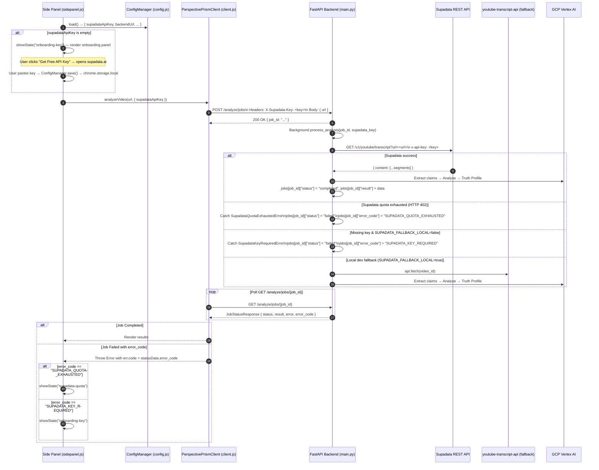
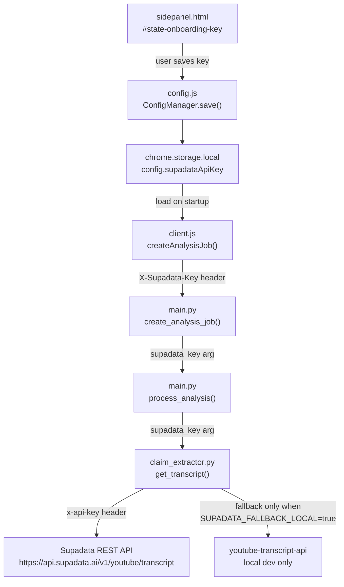

# BYOK API Key Management & Supadata YouTube Transcript Integration — Design Specification

## 1. Overview

This specification introduces two tightly coupled features:

1. **BYOK Onboarding UX**: A structured key-management layer in the Chrome extension that gates analysis on the user supplying a valid Supadata API key, surfaces an onboarding modal explaining the free tier, and persists the key in `chrome.storage.local`.
2. **Supadata Transcript Integration**: A per-request transcript fetch pipeline in the FastAPI backend that receives the user's Supadata key via a request header (`X-Supadata-Key`) and uses it to bypass YouTube's cloud IP blocking — replacing the current unproxied `youtube-transcript-api` call that returns `RequestBlocked` from Modal's datacenter IPs.

The two features are architecturally coupled at the `POST /analyze/jobs` API boundary: the extension supplies the key as a request header; the backend consumes it per-request without storing it server-side.

---

## 2. Architecture

### 2.1 End-to-End Request Flow & Error Propagation



### 2.2 Key Storage & Propagation

| Layer | Storage | How key moves |
|---|---|---|
| Chrome Extension | `chrome.storage.local` → `config.supadataApiKey` | Loaded on startup; synchronized across pages via `chrome.storage.onChanged` and reloaded before each analysis request |
| Side Panel → Client | In-memory, passed as `options.supadataApiKey` to `analyzeVideo()` | Re-read from storage before dispatch; never written to DOM or logs |
| Web Frontend | `localStorage` → `perspective_prism_supadata_key` | Optional client BYOK input in `frontend/src/App.tsx`; passed in `X-Supadata-Key` header |
| Client → Backend | `X-Supadata-Key` request header on `POST /analyze/jobs` | Single HTTPS hop, TLS-encrypted |
| Backend | **Not stored** — read from `Request.headers`, passed to `ClaimExtractor.get_transcript()` per call | Discarded after each request. Deployments serving the web frontend can configure `SUPADATA_API_KEY` in `Settings` as a server-side default for keyless requests. |

> [!IMPORTANT]
> The Supadata key is **never stored server-side**. It is read from the `X-Supadata-Key` header, passed in-memory to `ClaimExtractor`, used for one Supadata API call, and discarded. This mirrors the `/health/llm` `X-Probe-Key` per-request pattern already in production.

### 2.3 Component Topology



### 2.4 Onboarding Panel UX

The onboarding experience renders inside the Native Side Panel as a new `#state-onboarding-key` state, consistent with ADR 002. It is shown when:
- The extension is first installed and no key is present
- The user clicks "Change API Key" in the options/settings page
- The backend returns an error code `SUPADATA_KEY_MISSING` or `SUPADATA_QUOTA_EXHAUSTED`

```
┌─────────────────────────────────────────────────────────┐
│  🔑  Set Up Your Free Transcript Key                    │
│                                                         │
│  Perspective Prism uses Supadata to fetch YouTube       │
│  transcripts from the cloud. Supadata's free tier       │
│  includes 100 transcript fetches per month —            │
│  no credit card required.                               │
│                                                         │
│  ┌───────────────────────────────────────────────────┐  │
│  │  1. Sign up at supadata.ai  (free, ~30 seconds)  │  │
│  │  2. Copy your API key from the dashboard         │  │
│  │  3. Paste it below and click Save                │  │
│  └───────────────────────────────────────────────────┘  │
│                                                         │
│  API Key  [________________________]  👁                │
│                                                         │
│  [  Get Free Key ↗  ]      [  Save & Continue  ]       │
│                                                         │
│  ℹ Your key is stored locally on this device only.     │
│    It is sent to Supadata on your behalf to fetch       │
│    transcripts and never stored on our servers.         │
└─────────────────────────────────────────────────────────┘
```

The options page (`options.html` / `options.js`) gains a matching "API Keys" section with the same field so the key can be updated without re-triggering the full onboarding flow.

### 2.5 Backend Fallback Chain & Error Codes

```
1. Client X-Supadata-Key header (User BYOK)
        ↓ absent
2. Server-side settings.SUPADATA_API_KEY (Web deployment default / server fallback)
        ↓ absent
3. youtube-transcript-api (LOCAL DEV ONLY — SUPADATA_FALLBACK_LOCAL=true)
        ↓ absent / disabled
4. Structured Error Termination:
   - Supadata HTTP 402 → status: "failed", error_code: "SUPADATA_QUOTA_EXHAUSTED"
   - Supadata HTTP 401/403 → status: "failed", error_code: "SUPADATA_KEY_INVALID"
   - Missing key & fallback disabled → status: "failed", error_code: "SUPADATA_KEY_REQUIRED"
```

> [!NOTE]
> The `youtube-transcript-api` fallback is gated by `settings.SUPADATA_FALLBACK_LOCAL` (default `False`). In Modal production only Supadata is attempted. Local development can set `SUPADATA_FALLBACK_LOCAL=true` in `.env` to test the full pipeline without a Supadata key.
> In all failure cases, the failure is reported via `JobStatusResponse.error_code` so clients can render targeted, actionable UI states rather than generic error messages.

---

## 3. Architectural Constraints

### 3.1 Extension Invariants (ADR 002 / ADR 004)
- All UI renders inside the Native Side Panel — no browser popups, no content-script overlays.
- Zero-build vanilla JS — no bundler. The onboarding state is a new `#state-onboarding-key` container in `sidepanel.html` using existing CSS variables.
- `supadataApiKey` stored exclusively in `chrome.storage.local`. `chrome.storage.sync` is prohibited for secrets.
- **Storage Change Synchronization & Dynamic Key Reload**: The extension MUST listen to `chrome.storage.onChanged` for changes to `config` in `local` storage and re-read `ConfigManager.load()` prior to dispatching each analysis request. This ensures that saving a replacement key in the Options page (or another tab) immediately updates any active, already-open Side Panel instance.
- The key input field must be `type="password"` with a toggle-visibility button.
- `ConfigValidator.validate()` must accept and validate `supadataApiKey` as an optional string (non-empty string passes; `undefined` or `""` passes validation but gates analysis flow).

### 3.2 Backend Invariants (AGENTS.md)
- `X-Supadata-Key` is declared via FastAPI `Header(default=None)` — optional, typed `str | None`.
- The key flows as a positional argument: `create_analysis_job()` → `process_analysis()` → `ClaimExtractor.get_transcript()`. Never stored in `os.environ`, `jobs{}`, or any persistent state.
- Supadata HTTP call uses `httpx.AsyncClient` (non-blocking, consistent with ADR 003 async I/O standard).
- `JobStatusResponse` schema MUST include `error_code: Optional[str] = None`. When background processing encounters a domain exception (such as `SupadataQuotaExhaustedError` or `SupadataKeyRequiredError`), `process_analysis()` records `jobs[job_id]["error_code"] = e.code` alongside `jobs[job_id]["error"] = str(e)`.
- **Test Transport Standard**: With `httpx>=0.28.1`, tests MUST NOT pass `app=app` directly to `AsyncClient`. All test suites must instantiate `transport = ASGITransport(app=app)` and pass `AsyncClient(transport=transport, base_url="http://test")`.

### 3.3 Web Frontend Invariants
- Standalone web frontend (`frontend/src/App.tsx`) calls `POST /analyze/jobs` directly.
- **Client BYOK Setup Path**: The web UI provides an optional API key input / settings modal, persisted in browser `localStorage` under `perspective_prism_supadata_key`, and forwards it via `headers: { "X-Supadata-Key": key }`.
- **Server Deployment Requirement**: Deployments serving the web frontend without client BYOK MUST configure `SUPADATA_API_KEY` in `Settings` (e.g. Modal secret or `.env`) so keyless web requests succeed transparently via the server default.

### 3.4 New Backend Settings Fields

| Field | Type | Default | Purpose |
|---|---|---|---|
| `SUPADATA_API_KEY` | `str` | `""` | Optional server-side dev / web deployment key (Modal secret or `.env`) |
| `SUPADATA_FALLBACK_LOCAL` | `bool` | `False` | Enables `youtube-transcript-api` fallback for local dev |
| `SUPADATA_BASE_URL` | `str` | `"https://api.supadata.ai/v1"` | Override for testing |
| `SUPADATA_TIMEOUT` | `float` | `20.0` | Per-request timeout for Supadata calls |

### 3.5 New Extension Config Fields

| Field | Type | Default | Validation rule |
|---|---|---|---|
| `supadataApiKey` | `string` | `""` | Optional; non-empty string if present |

---

## 4. Compliance & ADR Traceability

| Invariant | Compliance Mechanism |
|---|---|
| **ADR 002 (Native Side Panel)** | Onboarding is `#state-onboarding-key` in Side Panel; no browser popup |
| **ADR 003 (Vertex AI async I/O)** | Supadata fetch uses `httpx.AsyncClient` with `await` |
| **ADR 004 (Zero-build extension)** | Onboarding UI is vanilla JS + existing CSS custom properties |
| **AGENTS.md BYOK isolation** | Key stored in `chrome.storage.local` only; never logged; never synced |
| **AGENTS.md IPC origin verification** | `background.js` `sender.id` check unchanged; key forwarded via existing message channel |
| **Modal deployment spec §2.3** | `SUPADATA_API_KEY` added as optional entry in `perspective-prism-gcp-secrets` for server-side dev use |
